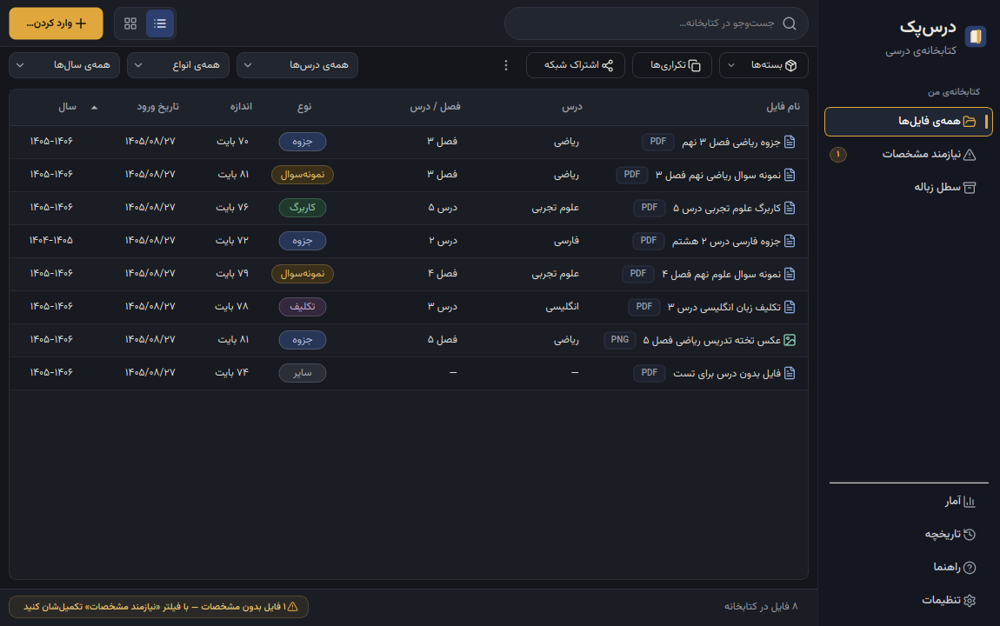

# DarsPack — درس‌پک

[](https://github.com/AFG473319/DarsPack/actions/workflows/ci.yml)
[](https://github.com/AFG473319/DarsPack/releases)
[](LICENSE)
[](https://www.python.org/)

**All your school files — notes, sample exams and worksheets — in one findable place. Offline-first, Persian-first, no account, no internet needed.**

**همه‌ی فایل‌های درسی‌ات — جزوه، نمونه‌سوال و کاربرگ — در یک جای مرتب و قابل جست‌وجو. آفلاین، فارسی‌اول، بدون نیاز به حساب کاربری یا اینترنت.**

DarsPack (درس‌پک) is a Windows desktop app for Iranian middle-school students. It keeps class notes (جزوه), sample exams (نمونه‌سوال) and worksheets (کاربرگ) organized by subject, chapter and kind — and it can serve a phone-friendly web client over your local Wi-Fi, so you can reach your library from your phone at home.

> ⭐ If DarsPack looks useful to you, a star helps other students and parents find it.



## Download — دانلود

Ready-to-install builds are on the [GitHub Releases](https://github.com/AFG473319/DarsPack/releases) page:

- **Latest** — `DarsPack-Setup.exe` (per-user installer, no admin needed) or a portable zip
- **Pre-release** — beta builds for testing (`vX.Y.Z-beta.N`)
- Every release ships `SHA256SUMS.txt` — verify your download before running it

نسخه‌ی آماده‌ی نصب را از صفحه‌ی [Releases](https://github.com/AFG473319/DarsPack/releases) بگیرید: فایل `DarsPack-Setup.exe` را نصب کنید؛ نیازی به دسترسی مدیر (admin) نیست.

> Status: **working v0.1** — core engine, RTL desktop UI, LAN phone client and the Windows build are implemented and covered by 403 automated tests. See `docs/limitations.md` for known limitations.

## Who it's for

- **Students** who keep getting lost in folders full of PDFs named `final2.pdf`
- **Parents** who want their child's school materials backed up in one portable package
- **Teachers** who share notes and sample exams and want a class set that stays verifiable and complete

## What works

- Drag-and-drop or file/folder picker import into an app-managed library (copy + SHA-256 + crash-safe), with a **classification review dialog** after every import — categorizing is the app's main job; the subject is never guessed behind your back.
- Normalized Persian search («فصل ۳» = «فصل 3», Arabic ي finds Persian ی), subject/chapter/kind filters, tags, notes.
- Duplicate detection (same content) and version-conflict detection (same name, different content) — **flagged, never auto-deleted**.
- **Manual delete, shortcuts and bulk actions** — Delete key, «حذف» button or right-click anywhere on a row; select several files (Ctrl/Shift) to remove them together (moved to the library's `.trash` folder, never erased) or reclassify them in one form. Keyboard shortcuts: Enter to open, Ctrl+E to edit metadata, Esc to clear search/selection, F5 to refresh; column header click-to-sort with visual indicators.
- Portable «درس‌پک» packages: ZIP + JSON manifest + per-file hashes + offline RTL index; verify detects exactly which files are missing/corrupt.
- Optional LAN sharing: PIN-protected web client for phones on the same Wi-Fi (search, inline viewing for PDFs/images/text, download, multi-file upload) with a web-app manifest for «Add to Home screen».
- **Built-in Model Context Protocol (MCP) server & 1-click AI integration**: Connect AI agents (Claude Code, OpenCode, Antigravity, Cursor, Hermes, OpenClaw) directly to the library. The server runs as a separate headless process (`DarsPackMcp.exe`) — no window, no network — and the in-app Help Center (F1) offers a 1-click prompt generator plus a `--selftest` health check.
- Persian-first dark RTL UI with the bundled Vazirmatn typeface, one consistent icon set, a compact app bar and toolbar, kind badges, Persian/English toggle, in-app feedback (star rating + topic, online submission optional — see `docs/feedback-setup.md`), activity log; one-command Windows build.

---

## درس‌پک چیست؟ (فارسی)

درس‌پک یک برنامه‌ی ویندوزی برای دانش‌آموزان دوره‌ی متوسطه است که فایل‌های درسی — جزوه، نمونه‌سوال و کاربرگ — را بر اساس درس، فصل و نوع فایل مرتب می‌کند تا همیشه سریع پیدا شوند.

- **کاملاً آفلاین:** اینترنت لازم نیست؛ کتابخانه روی خودِ کامپیوتر شماست.
- **جست‌وجوی فارسی واقعی:** «فصل ۳» و «فصل 3» یک نتیجه می‌دهند و حروف عربی و فارسی (ی/ي، ک/ك) درست تشخیص داده می‌شوند.
- **بدون حذف خودکار:** فایل‌های تکراری یا نسخه‌های متفاوت فقط علامت زده می‌شوند؛ تصمیم همیشه با شماست.
- **قابل حمل:** از کتابخانه‌تان یک بسته‌ی «درس‌پک» (ZIP) بسازید و روی هر کامپیوتری — حتی بدون نصب درس‌پک — کامل و سالم بودنش را بررسی کنید.
- **دسترسی با گوشی:** اگر بخواهید، می‌توانید روی همان وای‌فای خانه با گوشی هم به کتابخانه دسترسی داشته باشید؛ این قابلیت اختیاری است و با رمز (PIN) محافظت می‌شود.
- **رابط کاربری فارسی و راست‌چین** با فونت وزیرمتن و امکان تغییر زبان به انگلیسی.

دانلود: از صفحه‌ی [Releases](https://github.com/AFG473319/DarsPack/releases) فایل `DarsPack-Setup.exe` را بگیرید و نصب کنید.

اگر درس‌پک برایتان مفید بود، با یک ستاره ⭐ در گیت‌هاب به دیده شدنش توسط دانش‌آموزان و والدین دیگر کمک می‌کنید.

---

## Key ideas

- **Manual import into an app-managed library** — files are copied in, hashed (SHA-256) and cataloged by subject, chapter, lesson, kind and school year (Jalali calendar).
- **Duplicates and version conflicts are flagged, never auto-deleted** — the user always decides.
- **Portable «درس‌پک» packages** — a ZIP with a JSON manifest, per-file SHA-256 hashes and an offline browsable index; anyone can verify a package's completeness and integrity, even without DarsPack installed.
- **Fully offline by default** — the LAN share is opt-in per session and PIN-protected.
- Built for low-end hardware and Persian text: ی/ي and ک/ك normalization, Persian/Latin digits, half-space (ZWNJ) handling, Jalali dates.

## In this repository

| Path | Contents |
|---|---|
| `docs/architecture.md` | Module map, SQLite schema, package format, LAN protocol, test strategy |
| `docs/dependencies.md` | Dependency register (what / why / licence / size) |
| `docs/limitations.md` | Known limitations and measured performance on the target laptop |
| `docs/feedback-setup.md` | Optional online feedback endpoint setup |
| `docs/mcp.md` | Model Context Protocol (MCP) server configuration for AI agents |
| `docs/ci.md` | CI checks and the tag-driven release process (GitHub Actions) |
| `eval/benchmark-plan.md` | Controlled benchmark: find-time, duplicate/conflict detection accuracy, package verification |
| `installer/` | PyInstaller spec + one-command build script (`build.bat`) |

## Run and build

From source (Python 3.12+, SQLite and the packages in `docs/dependencies.md`):

```
python -m venv .venv
.venv/Scripts/pip install -r requirements-dev.txt
.venv/Scripts/pip install -e .          # or add src/ to PYTHONPATH
.venv/Scripts/python -m darspack
```

Tests: `.venv/Scripts/python -m pytest tests/`

Windows build (produces `dist/DarsPack/DarsPack.exe`, a portable app folder):

```
installer\build.bat
```

## License

[GNU General Public License v3.0 or later (GPL-3.0-or-later)](LICENSE).

Bundled assets have their own permissive licenses:
- **Vazirmatn** font: [SIL Open Font License 1.1](src/darspack/assets/fonts/OFL.txt)
- **Lucide** icons: [ISC License](src/darspack/assets/icons/LICENSE)
